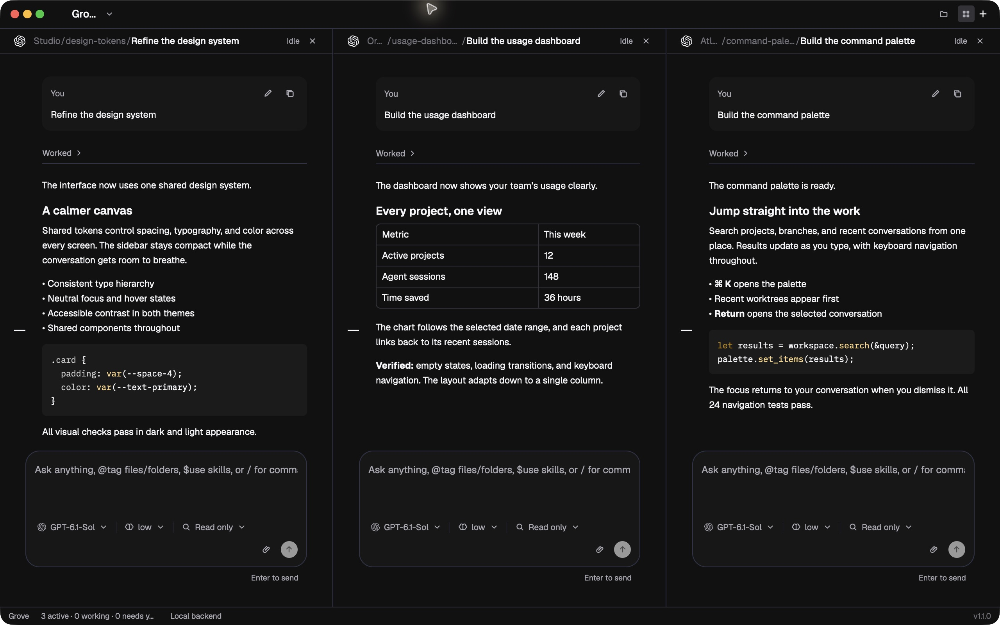

<div align="center">

# Grove

**Your projects. Your worktrees. Your agents. One native app.**

Run Codex, Claude Code, OpenCode, and terminals side by side, without losing your place.

[Download Grove](https://github.com/gitfudge0/grove/releases/latest) · [Release notes](RELEASE_NOTES.md) · [MIT](LICENSE-MIT) / [Apache-2.0](LICENSE-APACHE)



<sub>Actual Grove UI. Fictional projects and conversations.</sub>

</div>

## Install

Download your installer from the [latest release](https://github.com/gitfudge0/grove/releases/latest):

- **macOS:** open the `.dmg` for Apple Silicon (`arm64`) or Intel (`x86_64`), then drag Grove to Applications.
- **Linux:** install the `.deb` for `amd64` with `sudo apt install ./Grove-*.deb`. Requires a graphical X11 or XWayland session.
- **Windows (alpha):** run the `.msi`. Expect rough edges.

Or install the latest prebuilt release from the command line on macOS or amd64 Linux (no Rust toolchain required):

```sh
curl -fsSL https://raw.githubusercontent.com/gitfudge0/grove/main/install.sh | bash
```

To build from a remote source checkout instead (requires Rust, Git, and the [development prerequisites](#develop)):

```sh
curl -fsSL https://raw.githubusercontent.com/gitfudge0/grove/main/install.sh | bash -s -- --source
```

Download failures stop the installer; it never silently compiles from source. Remote installs use the repository's latest published release, while `GROVE_REPO_REF` selects the branch or tag for `--source`.

Install [Git](https://git-scm.com/) and your preferred agent CLI separately, and sign in through that CLI. Grove uses the tools already on your machine. `tmux` is optional on macOS and Linux for persistent terminal sessions.

Open Grove, add a project folder, then start a conversation in the main checkout or create a worktree. Enable **Settings → Native Agents (experimental)** for native Codex and Claude Code transcripts on macOS and Linux. Toggle grid mode with **⌘G** on macOS or **Ctrl+Shift+G** on Linux.

### macOS security prompt

If macOS blocks Grove, try opening it once, then go to **System Settings → Privacy & Security → Open Anyway** ([Apple’s instructions](https://support.apple.com/102445)).

If needed, remove quarantine from the downloaded Grove app only, then reopen it:

```sh
xattr -dr com.apple.quarantine /Applications/Grove.app
```

## Develop

Install [Rust](https://rustup.rs/) and Git. On macOS, install the command line tools with `xcode-select --install`. Linux needs the system packages listed in the [build workflow](.github/workflows/release.yml); Windows uses Rust’s MSVC toolchain and the C++ build tools.

```sh
git clone https://github.com/gitfudge0/grove.git
cd grove
cargo run
```

To build and install an app locally on macOS or Linux:

```sh
./install.sh
```

The script installs `cargo-bundle` if needed and uses the `local` profile, which skips release LTO and allows parallel code generation. Use `./install.sh --release` for the optimized shipping profile. Native macOS builds share Cargo's normal target directory; a translated toolchain explicitly targets native hardware to avoid a Rosetta app. `CARGO_TARGET_DIR` is respected. On Windows, use `cargo run` for development.

Build artifacts remain cached to speed up subsequent builds. To reclaim space explicitly, run `cargo clean --profile local` or `cargo clean --release`; `cargo clean` removes all artifacts for this checkout and makes the next build slower. Older installers may have left `target/aarch64-apple-darwin` or `target/x86_64-apple-darwin` artifacts; `cargo clean --target <triple> --release` removes that target's old release artifacts. The installer never clears caches automatically.

To disable anonymous usage telemetry, turn off **Share anonymous usage data** in Settings or set `GROVE_TELEMETRY=off`.
