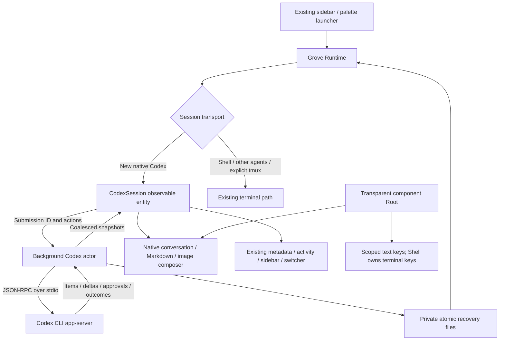

# Code Review - feat/codex-native-sessions

## Summary

The working changes replace new Codex sessions' PTY content with a native conversation backed by the Codex CLI app-server, while retaining Grove's projects, worktrees, sidebar, shared session headers, grid, shells, and other agents. The final source review found no outstanding substantive correctness or security issue after the submission-settlement, streaming-selection, clipboard-image, and terminal-keyboard corrections described below. Installed native visual acceptance remains unverified.

Scope: `git log main..HEAD` and `git diff main...HEAD` are empty because the implementation is uncommitted. This review therefore covers the working-tree changes against HEAD/main, including new files inspected with `git diff --no-index`; it does not imply committed delivery. Source analysis used Git commands only. The reviewer ran no builds, tests, servers, or application commands.

## Files Changed

Line counts below describe the reviewed snapshot and exclude this report.

| File Path | Change Type | Purpose of Changes | Lines Changed | Impact Assessment |
|-----------|-------------|-------------------|---------------|-------------------|
| Cargo.lock | Modified | Existing image/base64 dependency resolution | +2/-0 | Low |
| Cargo.toml | Modified | Explicit clipboard raster decoders | +3/-0 | Bounded dependency surface |
| README.md | Modified | Native transport and compatibility documentation | +15/-9 | User-facing contract |
| crates/grove-core/Cargo.toml | Modified | Image payload encoding | +1/-0 | Low |
| crates/grove-core/src/agent.rs | Modified | Shared executable detection/launch resolution | +135/-24 | All agent launchers |
| crates/grove-core/src/env_path.rs | Modified | Internal environment type visibility | +1/-1 | Low |
| crates/grove-core/src/lib.rs | Modified | Expose Codex backend | +1/-0 | Internal API |
| crates/grove-core/src/codex.rs | Added | Actor, protocol projection, persistence, lifecycle, regression tests | +1879 | Core integration |
| crates/grove-core/examples/codex_native_smoke.rs | Added | Opt-in real-provider smoke | +180 | Verification only |
| src/app.rs | Modified | Component Root initialization contract | +2/-1 | Window-wide |
| src/entities/activity_store.rs | Modified | Native activity projection | +19/-0 | Shared activity |
| src/entities/mod.rs | Modified | Register observable entity | +1/-0 | Low |
| src/entities/codex_session.rs | Added | Actor snapshots and tracked submission API | +103 | UI/backend boundary |
| src/entities/session_registry.rs | Modified | Native ownership, shutdown, metadata propagation | +59/-0 | Shared session lifecycle |
| src/icons.rs | Modified | Shared copy icon | +2/-0 | Low |
| src/main.rs | Modified | Transparent Root wrapper for real selection | +20/-16 | Window-wide |
| src/project_service.rs | Modified | Test fixture isolation | +2/-2 | Test-only |
| src/runtime.rs | Modified | Spawn/restore/title/shutdown integration | +295/-0 | Shared runtime |
| src/settings.rs | Modified | Production-config isolation regression | +43/-1 | Test-only storage selection |
| src/theme.rs | Modified | Component palette and selection integration | +22/-10 | Shared theme |
| src/views/mod.rs | Modified | Register native view | +1/-0 | Low |
| src/views/codex_view.rs | Added | Native conversation, Markdown, selection, images, composer, tests | +1190 | Primary product surface |
| src/views/settings_panel.rs | Modified | Native transport wording and graceful restart | +3/-3 | Settings lifecycle |
| src/views/shell.rs | Modified | Shutdown, switcher status, terminal-backend copy | +25/-15 | Shared shell |
| src/views/sidebar.rs | Modified | Native view focus, status, launcher errors, tests | +230/-13 | Shared navigation |
| src/views/sidebar/content.rs | Modified | Preserve shared headers/grid with native body | +165/-10 | Shared session canvas |
| src/views/sidebar/project_setup.rs | Modified | Explicit fixture environment | +1/-0 | Test-only |
| src/views/sidebar/projects.rs | Modified | Explicit fixture environment | +2/-2 | Test-only |
| src/views/statusbar.rs | Modified | Native session summary | +10/-1 | Shared status |
| src/views/worktree_launcher.rs | Modified | Visible actionable launch errors | +53/-9 | Shared launchers |
| vendor/gpui-component/README.md | Modified | Record focused vendor patches | +15/-0 | Maintenance documentation |
| vendor/gpui-component/ui/src/input/state.rs | Modified | Opt-in image paste event | +35/-4 | Existing inputs default unchanged |
| vendor/gpui-component/ui/src/lib.rs | Modified | Register focused Root changes | +1/-1 | Low |
| vendor/gpui-component/ui/src/root.rs | Modified | Remove conflicting global keys; preserve copy whitespace | +9/-15 | Terminal/input interaction |
| vendor/gpui-component/ui/src/text/state.rs | Modified | Correct queued streaming parse and preserve height-growing selections | +32/-4 | Formatted text |
| vendor/gpui-component/ui/src/text/text_view.rs | Modified | Incremental updates, scoped Copy/Escape | +13/-3 | Formatted text |

## System Flow Impact

## Critical Issues

No outstanding critical issue found in the final source reviewed. Earlier verified defects were corrected before this assessment: image-only input clearing before acknowledgement; stale or unrelated acknowledgements clearing drafts; stale rejection clearing a retried submission token; global Root Tab intercepting terminal input; and streaming parser/height changes losing output or selection.

## Quality Issues

No additional blocking quality finding. The actor is substantial, but owns protocol I/O, pending requests, process lifetime, and recovery in one boundary; the GPUI entity and view remain separate. Vendor changes are focused and documented rather than carrying the accidental unrelated formatting churn observed during implementation.

## Architecture Feedback

The shared Grove session header/grid/navigation path is retained; native Codex substitutes its body and state projection. Unique local submission IDs flow through actor requests and accepted/rejected outcomes, so UI draft settlement is tied to the specific request instead of empty draft text or a shared prompt counter. Other providers and explicit tmux remain on their existing transport.

## Security Assessment

Process arguments use structured invocation. Existing CLI authentication and configured sandbox defaults are retained; broad bypass applies only to the existing explicit setting. Approvals validate thread/turn identity and unsupported requests fail closed. Recovery keys are restricted, files are atomic and private, stderr diagnostics stay session-local, and clipboard inputs accept embedded raster data rather than fetching pasted network/file URLs. Screenshot decoding uses input, dimension, and allocation bounds off the UI thread.

## Performance Analysis

Backend I/O and clipboard raster decoding run off the UI thread. Immutable preview images reuse their GPUI identity, with cache eviction for URLs absent from both history and current attachments; this fixes repeated image decoding/allocation on streaming frames. The transcript still grows with session history and receives cloned snapshots, so exceptionally long conversations remain a profiling opportunity rather than a demonstrated release blocker.

## Testing Evaluation

Reviewed tests cover provider rejection and exact acknowledgement, stale snapshots, image-only retry, unrelated submission outcomes, streamed Markdown, real drag selection/copy, code indentation, Escape, terminal raw keys under Root, Shift+Enter, screenshot normalization, native focus, shared grid/header controls, lifecycle cleanup, recovery, routing, additional roots, and production-config isolation. The verification scripts distinguish protocol/runtime checks from visual interaction acceptance.

The reviewer did not execute tests. Final independent build/test/lint/install results belong to the parent verification run and must not be inferred from this source review. Native CUA inspection is unavailable (`apps: []`, `browsers: []`, native-pipe startup failure), so actual installed contrast, narrower-width layout, hover/focus states, and operating-system pasteboard interactions remain an explicit acceptance gap.

Parent verification reported from raw command output on the reviewed source:

- Workspace nextest: **1,144 passed, 2 skipped** in 16.979 seconds. Only equivalent lint corrections followed this run.
- All-target Clippy passed with the repository's test unwrap/expect allowances; production Clippy passed without those allowances. Scoped Cargo formatting, the five intended vendor modules' formatting, typos, and `git diff --check` passed. Cargo Machete found no unused dependencies; doctests completed successfully with zero doctests.
- The real-provider core smoke passed initialization, an effective additional writable root, streaming and command output, persisted same-thread resume and MARIGOLD recall, image color recognition, interruption, and stop cleanup.
- The optimized release built in 3m09s, bundled, signed with the configured identity, and installed to `/Applications/Grove.app`.
- Installed isolated real-provider acceptance passed **114 commands**, including sparse Finder-style PATH launch, native creation, actual prompt and `pwd`, Markdown/live updates, owner restart and same-thread recall, and session/recovery cleanup. Evidence: `/private/tmp/grove-native-codex-efheckw3/{summary,cleanup,owner,commands}.json`. Its designated owner exited and no owned child processes remained.
- A token-pair contrast calculation found body/metadata/composer ratios of 16.26/7.54/16.09 in dark and 18.40/5.70/16.00 in light. This supports palette contrast only; it is not rendered visual verification.

## Recommendations

- **Medium:** When the native inspection bridge is available, inspect the installed app in dark/light, list/grid, normal/narrow windows, and clipboard screenshot workflows. Do not represent source/test review as completed visual QA.
- **Low:** Profile long histories and multiple large images before adding virtualization or snapshot optimizations; avoid speculative restructuring without measured evidence.

## Approval Status

**Status**: requires_discussion

No open substantive source finding remains, and the independent automated/runtime gates passed. This status records the outstanding installed visual acceptance evidence, not a request for additional user permission.
